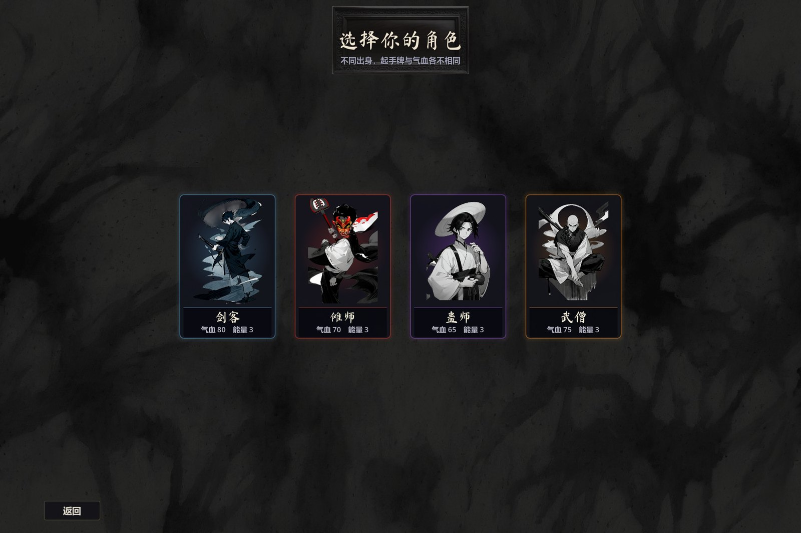
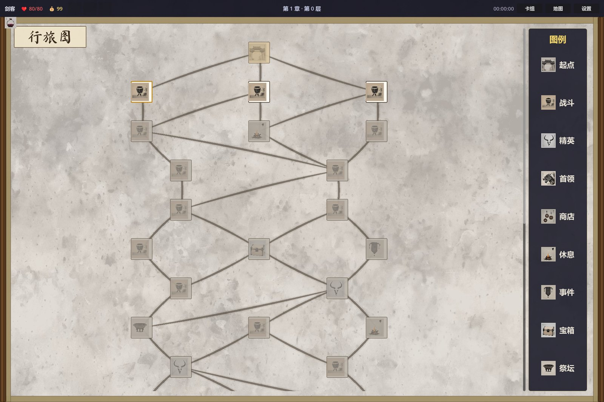
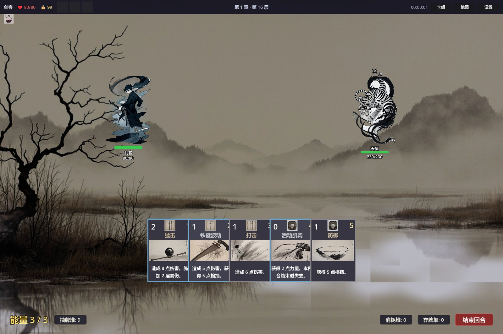

# 驱傩录

一款以商周傩仪、山海经异兽与江湖行旅为题材的单人卡牌 Roguelike。使用 Godot 4.6 开发，同时作为毕业论文《基于 Godot 引擎的 Roguelike 卡牌游戏设计与实现》的系统实现。

> 大傩之仪，方相氏率十二神兽，索室驱疫。你要做的，是在三章行旅中组建牌组、取舍遗物，把一路的邪祟逐出人间。

<p align="center">
  
  
  
</p>

## 玩法

- **四名角色**：剑客、傩师、蛊师、武僧，各自拥有独立初始牌组与起始遗物。
- **三章行旅**：每一章是一张分层地图，包含战斗、精英、商店、休息、事件与首领节点。
- **卡组构筑**：战斗胜利后从三张卡中择一，或在商店购买、在休息处升级卡牌。
- **遗物与药水**：遗物提供常驻效果，药水可在战斗内随时使用。
- **难度与种子**：开局可自选难度；每局有一个九位数字种子，相同种子可复现同一局。
- **图鉴与统计**：卡牌、遗物、药水图鉴，以及角色成就与对局历史。

## 操作

主要用鼠标操作：点选卡牌后点敌人或确认区打出，拖动或点击药水使用。

| 按键 | 功能 |
| --- | --- |
| A | 查看抽牌堆 |
| S | 查看弃牌堆 |
| D | 查看牌组 |
| X | 查看消耗堆 |
| E | 结束回合 |
| Space | 查看状态 |
| M | 打开地图 |
| H | 对局历史 |
| Esc | 打开/关闭菜单 |

按键可在「设定 - 操作设置」中修改。

## 下载试玩

[下载 v0.1.0 试玩版（Windows）](https://github.com/0zero0120/QuNuoLu/releases/latest)，文件名为 `QuNuoLu-v0.1.0-Windows.zip`。

- 下载后解压，运行 `驱傩录.exe` 即可，无需安装 Godot。
- 存档位于 `%APPDATA%\驱傩录\`，删除该目录即可清空进度。

## 从源码运行

1. 安装 [Godot 4.6.1](https://godotengine.org/download)。项目使用 GDScript，标准版即可；若用 .NET 版也可正常打开。
2. 用 Godot 导入本目录下的 `project.godot`。
3. 按 F5 运行。

导出 Windows 版：安装 4.6.1 导出模板后，在「项目 - 导出」中选择 Windows Desktop 预设。

## 目录结构

```
assets/      美术、音频、字体
resources/   角色、卡牌、遗物、敌人、事件等数据资源
scenes/      各界面与战斗场景
scripts/     核心逻辑、界面脚本与 autoload
addons/      Funplay MCP 编辑器辅助插件（开发期使用）
tools/       素材生成与处理脚本
```

## 反馈

试玩问题与建议请开 Issue，优先使用「试玩反馈」模板。反馈会用于毕业论文的易用性分析；是否同意匿名引用，请在反馈中注明。

## 许可与致谢

- 程序代码：[MIT License](LICENSE)。
- 自产美术、音频、文案与数据资源：[素材许可说明](LICENSE-ASSETS)（保留所有权利）。
- 第三方音频、字体、引擎与美术生成方式的完整说明见 [CREDITS.md](CREDITS.md)。
- 背景音乐含 Freesound 上 CC BY 4.0 授权的真录音片段，已按许可署名。
